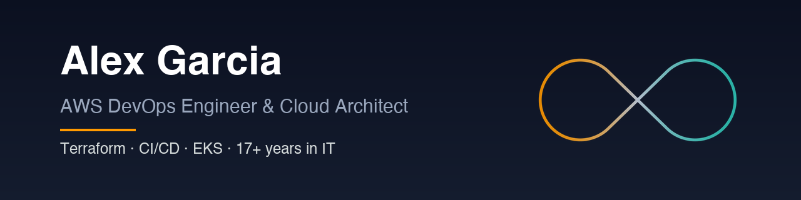
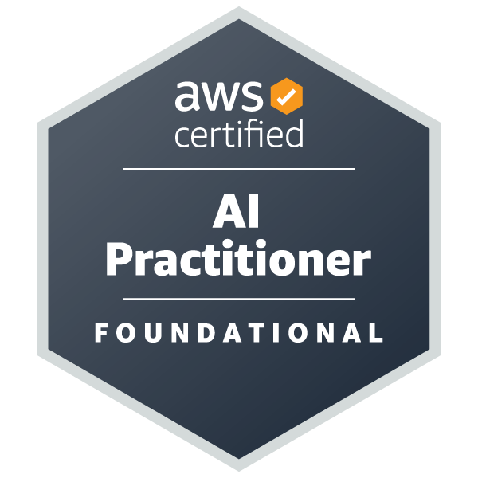
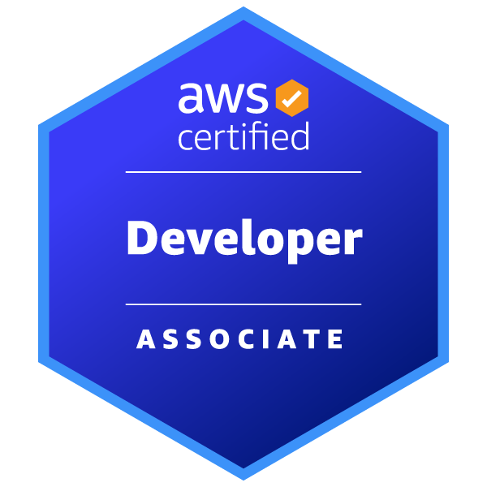
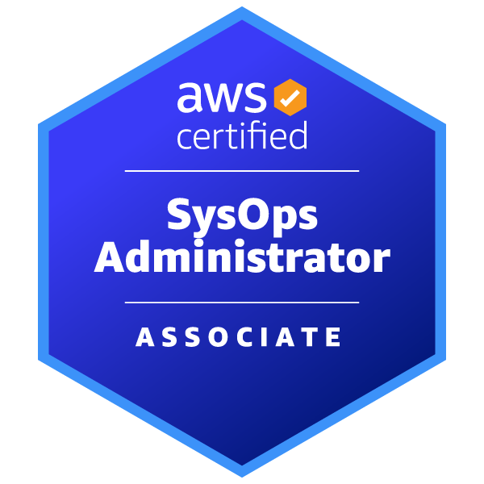
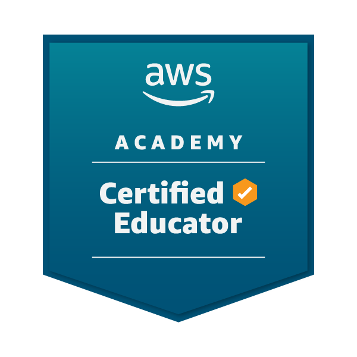
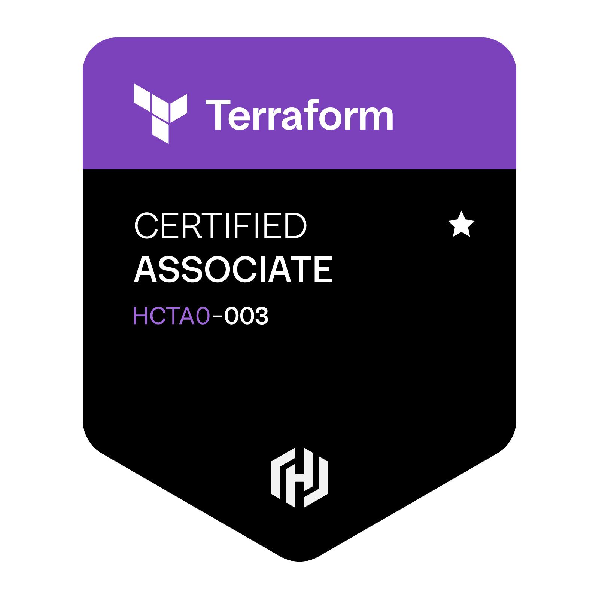

# Alex Garcia

AWS DevOps Engineer and Cloud Architect focused on DevOps and generative AI on AWS.

I'm an AWS DevOps engineer with more than 17 years in IT. I build AWS infrastructure, delivery pipelines and
generative AI platforms with Terraform, AWS CDK, CI/CD, containers and Amazon Bedrock, and I work with AI coding
assistants and MCP.

<table>
  <tr>
    <td align="center"><b>17+</b> years in IT</td>
    <td align="center"><b>7</b> certifications</td>
    <td align="center"><b>16</b> public repositories</td>
    <td align="center"><b>2</b> university courses taught</td>
  </tr>
</table>

## Projects

| Repository | Outcome |
| --- | --- |
| [`aws-devops-portfolio`](https://github.com/gamaware/aws-devops-portfolio) | Index of the projects in this portfolio, with a check that keeps them consistent |
| [`terraform-aws-rescue-lab`](https://github.com/gamaware/terraform-aws-rescue-lab) | Untrusted Terraform turned into tested modules with remote state and a plan gate |
| [`github-actions-aws-oidc-lab`](https://github.com/gamaware/github-actions-aws-oidc-lab) | Long-lived CI keys replaced by OIDC, and deploys that fail when ECS rolls back |
| [`aws-iam-security-review-sample`](https://github.com/gamaware/aws-iam-security-review-sample) | Security review report with ranked findings and a control-to-evidence map for SOC 2 |
| [`terraform-aws-eks-gitops-lab`](https://github.com/gamaware/terraform-aws-eks-gitops-lab) | EKS through Terraform modules, a Helm chart and Argo CD folders per environment |
| [`aws-ecs-fargate-deploy-lab`](https://github.com/gamaware/aws-ecs-fargate-deploy-lab) | API containerized and deployed to Fargate with a circuit breaker and alarm-based rollback |
| [`terraform-aws-landing-zone-lab`](https://github.com/gamaware/terraform-aws-landing-zone-lab) | Multi-account foundation with AWS Organizations and guardrails tested against real requests |
| [`aws-well-architected-assessment-sample`](https://github.com/gamaware/aws-well-architected-assessment-sample) | Assessment across the pillars and the DevOps lens, with a ranked backlog and roadmap |
| [`aws-cost-optimization-audit-sample`](https://github.com/gamaware/aws-cost-optimization-audit-sample) | Savings split into quick wins and planned work, each recalculated from billing data |
| [`aws-migration-runbook-sample`](https://github.com/gamaware/aws-migration-runbook-sample) | Wave plan, AWS DMS tasks and a timed cutover runbook with a way back |
| [`aws-devops-workshop-labs`](https://github.com/gamaware/aws-devops-workshop-labs) | Numbered labs on AWS, Terraform, CDK and CI/CD, each tested against its solution |
| [`terraform-aws-bedrock-rag-lab`](https://github.com/gamaware/terraform-aws-bedrock-rag-lab) | Private RAG API on Amazon Bedrock that cites its sources or refuses, with evaluation gates |
| [`terraform-aws-agentcore-agent-lab`](https://github.com/gamaware/terraform-aws-agentcore-agent-lab) | AI agent on Bedrock AgentCore whose every tool call is authorized per staff member |
| [`bedrock-genaiops-release-gate-lab`](https://github.com/gamaware/bedrock-genaiops-release-gate-lab) | Release gate that blocks prompt, model and guardrail changes failing quality, safety or cost |
| [`aws-genai-architecture-review-sample`](https://github.com/gamaware/aws-genai-architecture-review-sample) | GenAI review against the Generative AI Lens, with a fix per finding and a cost model |
| [`cdk-python-nag-pipeline-lab`](https://github.com/gamaware/cdk-python-nag-pipeline-lab) | CDK Pipelines app in Python that stops on any unacknowledged cdk-nag finding |

## Tech stack

AWS, Terraform, AWS CDK, CloudFormation, Amazon EKS, Amazon ECS, Helm, Argo CD, GitHub Actions, GitLab CI,
AWS CodePipeline, Docker, Python, Bash, Checkov, Trivy, Amazon Bedrock, Claude Code, OpenAI Codex, MCP.

## Certifications

  
  
  
  
  
  
  

## Teaching

<a href="https://iteso.mx/">
  <picture>
    <source media="(prefers-color-scheme: dark)" srcset="assets/iteso-dark.svg">
    
  </picture>
</a>

Adjunct professor of Cloud Architecture and Scalable Systems Design at ITESO, the Jesuit University of Guadalajara.

## Activity

  

